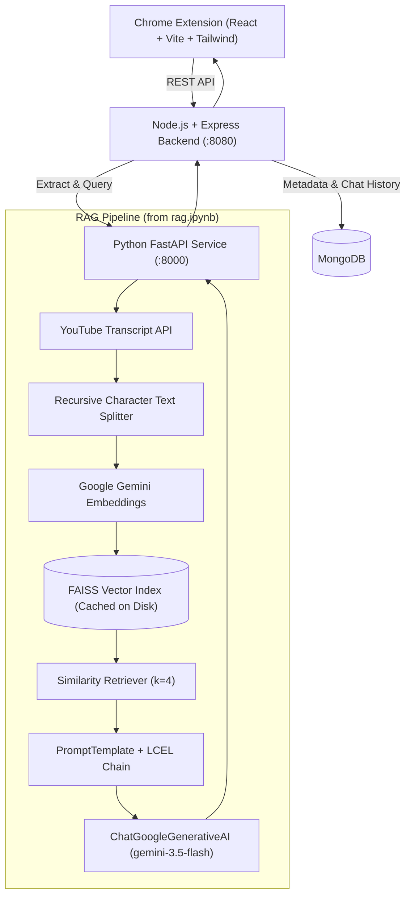

# ClipQuery – AI YouTube Assistant Chrome Extension

> **"Don't just watch videos. Understand them."**

ClipQuery is a lightweight, AI-powered Chrome Extension that transforms any YouTube video into an interactive conversation. By extracting video transcripts and processing them through a retrieval-augmented generation (RAG) pipeline powered by **LangChain**, **FAISS**, and **Google Gemini**, users can ask questions, get instant summaries, and jump to exact moments in the video with clickable timestamps.

---

## Architecture Overview



---

## Key Features

- **One-Click Video Processing:** Automatically detects the YouTube video currently playing in your active browser tab. Also supports manual pasting of standard links (`watch?v=`), short links (`youtu.be/`), and YouTube Shorts (`/shorts/`).
- **Interactive Timestamps:** AI answers cite source timestamps (e.g. `[02:15]`). Clicking any timestamp pill **automatically seeks the YouTube video player** to that exact second and resumes playback.
- **Local FAISS Index Caching:** Transcripts and vector embeddings are cached on disk (`ai-service/storage/<video_id>`). A video is only embedded once; subsequent questions load instantly with zero redundant embedding costs.
- **Custom User API Key Support:** Users can configure their own personal Google Gemini API key via the extension's Settings modal (`⚙`) to avoid shared rate limits and enjoy dedicated free quotas.
- **Full Chat Persistence:** Conversations are saved to MongoDB (`clipquery`), enabling session resumption and history management.
- **Smart Suggested Questions:** Instant one-click prompt pills (*"Summarize this video"*, *"What are the key takeaways?"*, *"Explain main concept"*).
- **Clean & Minimal UI:** Built with a distraction-free, compact layout designed specifically for Chrome's popup view.

---

## Tech Stack

| Layer | Technologies |
| :--- | :--- |
| **Frontend (Extension)** | React 18, Vite, Tailwind CSS, Lucide Icons, Chrome Extension Manifest V3 |
| **Application Backend** | Node.js, Express.js, MongoDB, Mongoose, Axios, Morgan |
| **AI Microservice** | Python 3.13, FastAPI, Uvicorn, LangChain, Google Gemini, FAISS, YouTube Transcript API |

---

## Project Structure

```
ClipQuery/
├── extension/                 # Chrome Extension (React + Vite + Tailwind)
│   ├── public/
│   │   ├── manifest.json      # Manifest V3 configuration
│   │   └── icons/             # 16px, 48px, 128px icons
│   ├── assets/icons/          # Design SVG & 1024px icon variants
│   ├── src/
│   │   ├── components/        # VideoInput, ChatWindow, ChatMessage, MessageInput, SettingsModal
│   │   ├── pages/Popup.jsx    # Extension popup container
│   │   ├── services/api.js    # API client & video seeking helpers
│   │   └── content/           # Content script injected into YouTube tabs
│   ├── .env.example           # Optional VITE_API_URL for deployed backend
│   └── dist/                  # Built extension loaded into Chrome
│
├── backend/                   # Node.js + Express Backend
│   ├── src/
│   │   ├── config/db.js       # MongoDB Mongoose connection
│   │   ├── controllers/       # videoController, chatController
│   │   ├── models/            # Video, Chat Mongoose schemas
│   │   ├── routes/            # /api/videos, /api/chat
│   │   ├── services/          # aiService (calls FastAPI)
│   │   ├── utils/youtube.js   # URL parser & oEmbed metadata fetcher
│   │   └── server.js          # Express entrypoint
│   └── .env                   # PORT, NODE_ENV, MONGO_URI, AI_SERVICE_URL
│
├── ai-service/                # Python FastAPI RAG Service
│   ├── app/
│   │   ├── routes/            # video.py (/process-video), chat.py (/ask)
│   │   ├── services/          # transcript, text_splitter, embeddings, vector_store, rag
│   │   ├── config.py          # Environment settings
│   │   └── main.py            # FastAPI entrypoint
│   ├── storage/               # Local FAISS indices cached by video ID
│   └── .env                   # HOST, PORT, ENV, GEMINI_MODEL, EMBEDDING_MODEL
│
└── README.md
```

---

## Getting Started

### 1. Prerequisites

- **Node.js** (v18 or higher) and `npm`
- **Python** (v3.10 or higher)
- **MongoDB** (running locally on `mongodb://127.0.0.1:27017` or via MongoDB Atlas)
- **Google Gemini API Key** ([Get one from Google AI Studio](https://aistudio.google.com/))

---

### 2. Setup & Run Python AI Service

```bash
# 1. Activate your virtual environment
source venv/bin/activate

# 2. Navigate to ai-service and install dependencies
cd ai-service
pip install -r requirements.txt

# 3. Configure environment variables (.env)
# Copy .env.example to .env (no shared GOOGLE_API_KEY needed — users enter their key in the Chrome Extension):
# HOST=0.0.0.0
# PORT=8000

# 4. Start the FastAPI server
uvicorn app.main:app --host 127.0.0.1 --port 8000 --reload
```
*Interactive Swagger docs will be live at `http://127.0.0.1:8000/docs`.*

---

### 3. Setup & Run Node.js Express Backend

In a new terminal:

```bash
# 1. Navigate to backend
cd backend

# 2. Install dependencies
npm install

# 3. Verify .env file:
# PORT=8080
# MONGO_URI=mongodb://127.0.0.1:27017/clipquery
# AI_SERVICE_URL=http://localhost:8000

# 4. Start the server
npm run dev
```
*The Express backend will start on `http://localhost:8080`.*

---

### 4. Build & Install Chrome Extension

In a third terminal:

```bash
# 1. Navigate to extension
cd extension

# 2. Install dependencies
npm install

# 3. (For deployment) Copy .env.example to .env and set VITE_API_URL to your deployed backend URL
# VITE_API_URL=https://your-clipquery-backend.onrender.com/api

# 4. Build the extension bundle
npm run build
```

#### Load into Google Chrome:
1. Open Chrome and navigate to: **`chrome://extensions/`**
2. Toggle on **"Developer mode"** in the top-right corner.
3. Click the **"Load unpacked"** button in the top-left.
4. Select the folder: **`extension/dist`**
5. Pin **ClipQuery** to your extensions bar!

---

## API Reference

### Express Backend (`http://localhost:8080`)

| Method | Endpoint | Description |
| :--- | :--- | :--- |
| `POST` | `/api/videos/process` | Accepts `{ url }`, validates video ID, indexes via FastAPI, returns metadata. |
| `GET` | `/api/videos/:videoId` | Returns video processing info and metadata. |
| `POST` | `/api/chat` | Accepts `{ videoId, question, conversationId }`, returns Gemini answer & timestamps. |
| `GET` | `/api/chat/:conversationId` | Fetches saved chat message history. |
| `DELETE` | `/api/chat/:conversationId`| Clears conversation history from database. |

### Python AI Service (`http://127.0.0.1:8000`)

| Method | Endpoint | Description |
| :--- | :--- | :--- |
| `POST` | `/process-video` | Accepts `{ video_id }`, extracts captions, chunks text, creates & saves FAISS index. |
| `POST` | `/ask` | Accepts `{ video_id, question }`, queries FAISS index, generates Gemini answer + timestamps. |
| `GET` | `/video-status/{video_id}` | Checks if FAISS index is already cached on disk. |

---

## License

MIT
